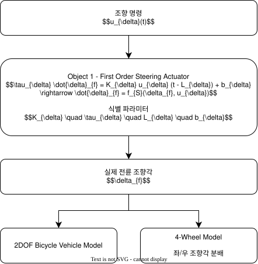

## Model S : 1DOF Steering Actuator
조향 명령 기반 액추에이터 동특성 식별

### 1. 모델의 목적
**조향 명령 (Steering Command)에 대한 실제 전륜 조향각의 동적 응답을 표현하고, 조향 액추에이터의 이득, 시간상수, 순수 시간지연 및 바이어스를 식별하여 조향계의 동특성을 예측하는 모델**이다.

1DOF Steering Actuator Model은 조향 명령이 실제 전륜 조향각으로 변환되는 과정을 1차 지연 시스템 (First-Order System)으로 근사한 모델이다.

조향 명령과 실제 조향각의 관계를 이용하여 다음 네 가지 특성을 식별한다.

- Steering Gain : 조향 명령에 대해 실제 조향각이 얼마나 크게 반응하는가?
- Time Constant : 조향 명령에 대해 실제 조향각이 얼마나 빠르게 반응하는가?
- Dead Time : 조향 명령 후 실제 조향각이 응답이 시작되기까지 얼마나 지연되는가?
- Steering Bias : 조향 명령이 0일 때 실제 조향각의 정상상태 편차는 얼마인가?

주요 식별 대상은 조향 게인 $K_{\delta}$, 시간상수 $\tau_{\delta}$, 순수 시간지연 $L_{\delta}$, 조향각 바이어스 $b_{\delta}$이며, 이를 통해 조향 명령 $u_{\delta}$에 따른 실제 전륜 조향각 $\delta_{f}$를 예측한다.

최종적으로 식별된 파라미터를 1차 동역학 모델로 구성하여 **2DOF Bicycle Model 및 4-Wheel Model에 실제 전륜 조향각을 제공하고, 조향 액추에이터의 동특성이 반영된 통합 Vehicle Plant를 구축**을 목표로 한다.

---
### 2. 도출 파라미터
|파라미터|명칭|의미|
|---|---|---|
|$K_{\delta}$|조향 게인|명령한 만큼 움직이는가?|
|$\tau_{\delta}$|시간상수|얼마나 빠르게 따라가는가?|
|$L_{\delta}$|순수 시간지연|명령 후 언제 반응하는가?|
|$b_{\delta}$|조향각 바이어스|명령이 0일 때 정상상태 각도는?|

---
### 3. 기본 운동방정식
$$\tau_{\delta}\dot{\delta}_{f}(t) + \delta_{f}(t) = K_{\delta}u_{\delta}(t) + b_{\delta}$$

이 식을 정리하면
$$\dot{\delta}_{f} = -\frac{1}{\tau_{\delta}}\delta_{f}(t) + \frac{K_{\delta}}{\tau_{\delta}}u_{\delta}(t) + \frac{b_{\delta}}{\tau_{\delta}}$$

이 운동방정식은 **조향 명령을 받은 실제 조향각이 목표 정상상태 각도를 향해 1차 지연으로 접근하는 경험적 동역학 모델**이다.

모터 관성, 마찰, 기어 강성, 조향 컬럼 강성 등의 각각 물리적으로 식별한 값이 아닌, 여러 효과들을 하나의 시간상수와 게인으로 근사한 모델이다.

---
### 4. 순수 시간지연 추가
실제 명령과 응답 사이에 시간지연이 확인된다면 $L_{\delta}$를 추가한다.
$$\tau_{\delta} \dot{\delta}_{f}(t) + \delta_{f}(t) = K_{\delta}u_{\delta}(t - L_{\delta}) + b_{\delta}$$

현재 1DOF Steering Actuator **최종 후보 방정식**이 된다.

- $L_{\delta}$ : 조향 명령이 모델에 반영되기까지 지연
- $\tau_{\delta}$ : 지연 이후 응답이 진행되는 속도
- $K_{\delta}$ : 정상상태에서 명령 변화가 실제 각도에 반영되는 비율
- $b_{\delta}$ : 일정한 조향각 오프셋

실측 데이터에서 시간지연이 구분되지 않는다면, $L_{\delta} = 0$으로 두고 시작한다.

---
### 5. 전달함수
바이어스를 제거한 편차변수 기준으로 라플라스 변환
$$(\tau_\delta s+1)\Delta_f(s) = K_\delta e^{-L_\delta s}U_\delta(s)$$

따라서
$$
G_S(s)=\frac{\Delta_f(s)}{U_\delta(s)}=\frac{K_\delta e^{-L_\delta s}}{\tau_\delta s+1}
$$

1차 지연과 순수 시간지연을 포함한 FOPDT (First-Order Plus Dead Time, 1차 지연 + 순수 시간지연) 모델이 된다.

순수 지연을 제외한 전달함수의 극점은 
$$p = -\frac{1}{\tau_{\delta}}$$
가 된다.

따라서 $\tau_{\delta} > 0$인 경우 1차 동역학은 안정적이 된다.

---
### 6. 상태공간방정식
상태변수를 실제 전륜 조향각으로 정의한다.
$$x_{s} = \delta_{f}$$

그러면

$$\dot{x}_{S}=A_{S}x_{S}+B_{S}u_{\delta}(t-L_{\delta})+g_{S}$$

여기서
$$A_{S} = -\frac{1}{\tau_{\delta}} \quad B_{S} = \frac{K_{\delta}}{\tau_{\delta}} \quad g_{S} = \frac{b_{\delta}}{\tau_{\delta}}$$
이 된다.

출력은
$$y_{S} = x_{S} = \delta_{f}$$
가 된다.

즉, 동적 상태는 실제 조향각 하나이다.

---
### 7. 이산시간 방정식
샘플링 시간 $\Delta{t}$에서
$$\delta_{f, k+1} = a_{\delta}\delta_{f, k} + c_{\delta}u_{\delta, k-m} + d_{\delta}$$
이고,
$$a_{\delta} = e^{-\Delta{t}/\tau_{\delta}}$$
$$c_{\delta} = (1 - a_{\delta})K_{\delta}$$
$$d_{\delta} = (1 - a_{\delta})b_{\delta}$$
가 된다.

이 식은 $L_{\delta} = m\Delta{t}$로 표현되는 정수 샘플 지연과 구간 내 일정한 입력 (ZOH)을 가정한다. 지연이 샘플 간격의 정수배가 아니면 입력 이력을 정확한 시각에 맞춰 처리해야 한다

차이점은 **입력이 조향 명령**이고, **출력이 실제 조향각**이다

---
### 8. 파라미터 식별
여기서 찾아야 하는 파라미터들은 아래와 같다
$$\theta_{s} = [K_{\delta} \quad \tau_{\delta} \quad L_{\delta} \quad b_{\delta}]^{T}$$
로 정의한다.

실측 조향각과 예측 조향각의 차이가 최소화되도록 최적화한다.

$$\hat{\theta_{S}}=\arg\min_{\theta_{S}}\sum_{k=1}^{N}
\left(
\delta_{f,k}^{\mathrm{meas}}
-\hat\delta_{f,k}(\theta_{S})
\right)^2
$$

실제 구현에서는 아래와 같이 진행한다.
1. 조향 명령과 실측 조향각의 단위/영점/시간 정렬 확인
2. 조향 명령에 대한 계단응답 등에서 $K_{\delta}, \tau_{\delta}, L_{\delta}$ 초깃값 추정
3. 초기값을 이용한 Free-run 출력오차 최소화
4. 조향 방향/진폭/속도별 파라미터 변화 확인
5. 사용하지 않은 시험 데이터에서 검증

#### 제약사항
**현재 확인된 VBOX 채널에 조향 명령과 실제 조향각이 별도로 존재하는지 불확실하다**  

두 신호가 확보되어야 액추에이터 응답을 독립적으로 식별할 수 있다.

---
### 9. 플랜트 검증 항목
|검증|확인할 내용|
|---|---|
|Step Steer|정상상태 게인, 시간상수, 순수 지연|
|Sine Steer|주파수별 진폭 및 위상|
|Ramp Steer|조향 속도 변화에 따른 추종 성능|
|Independent Data|새로운 명령 이력에 대한 예측 오차|

---
### 10. 2DOF Bicycle Model / 4륜 차량 모델과의 연결

이번 과정을 통해 얻어진 조향 액추에이터 모델을 사용하면서, 뒤에 연결하는 차량 플랜트만 교체할 수 있다. 

제한사항 : 4-wheel 차량 모델에서는 필요에 따라 좌/우 전륜 조향각을 별도로 계산해야 한다.