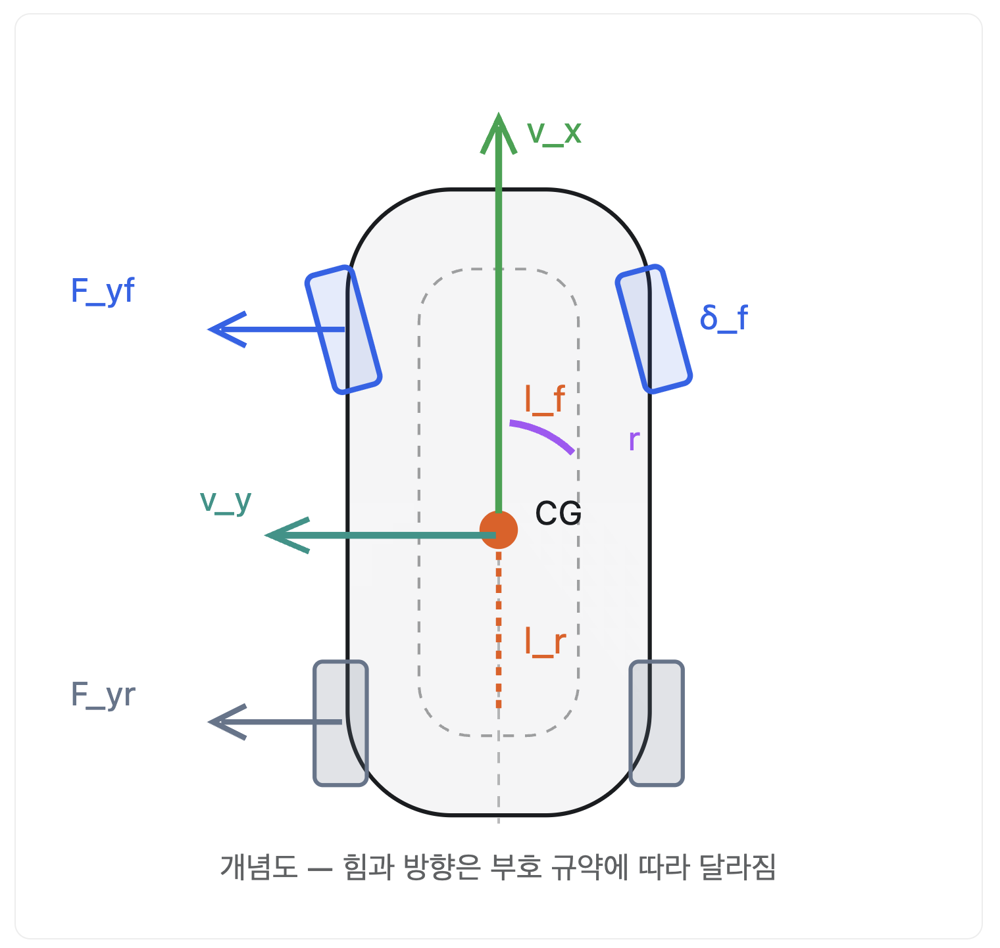

## Model B : 2DOF Bicycle Model
### 1. 모델의 목적
**실차 계측 데이터를 기반으로 차량의 횡방향 (Lateral) 및 요 (Yaw) 운동을 표현하고, 전/후륜 차축의 등가 코너링 강성을 식별하여 차량의 동적 응답을 예측하는 모델**이다.

2DOF Bicycle Model은 차량의 좌/우 바퀴를 전륜과 후륜의 등가 타이어로 단순화한 차량동역학 모델이다.

차량의 질량, 관성모멘트, 무게중심 위치 및 타이어 횡력을 이용하여 다음 두 가지 운동을 계산한다.
- Lateral Motion : 전/후륜 타이어 횡력에 따른 차량의 횡방향 운동
- Yaw Motion : 전/후륜 타이어 횡력이 발생시키는 요 모멘트에 따른 회전운동

주요 식별 대상은 전/후륜 차축의 등가 코너링 강성 $C_{f}, C_{r}$이며, 이를 통해 차량의 횡속도 $v_{y}$, 요레이트 $r$, 횡가속도 $a_{y}$를 예측한다.

최종적으로 식별된 파라미터를 상태공간방정식으로 구성하여 **Steering Actuator Model 및 향후 Roll Dynamics, 4-Wheel Model과 연계할 수 있는 제어용 Vehicle Plant를 확보**를 목적으로 한다.

---
### 2. 차량의 물리적 구조

- $m$ : 차량 질량
- $I_{z}$ : Yaw 관성모멘트
- $l_{f}, l_{r}$ : 무게중심에서 전/후륜 차축까지의 거리
- $C_{f}, C_{r}$ : 전/후륜 차축의 등가 코너링 강성
- $v_{x}, v_{y}$ : 종/횡방향 속도
- $r$ : Yaw Rate

여기서는 $C_{f}, C_{r}$는 개별 타이어 하나의 강성이 아니라 **차축에서의 등가 코너링 강성**으로 정의한다.

---
### 3. 첫 번째 운동방정식 - 횡방향 힘의 평형
뉴턴의 제2법칙부터 시작한다.
$$\sum F_{y} = ma_{y}$$

차량 좌표계에서 횡강속도는 아래와 같다.
$$a_{y} = \dot{v}_{y} + v_{x}r$$

따라서 전륜과 후륜 횡력이 만든 결과는
$$m(\dot{v}_{y} + v_{x}r) = F_{yf} + F_{yr}$$
이 된다.

직관적으로 보면, **차량의 횡방향 운동은 앞/뒤 타이어의 횡력 합으로 결정된다**는 의미가 된다.

---
### 4. 두 번째 운동방정식 - Yaw 모멘트 평형
차량 무게중심을 기준으로 회전운동에 대한 내용으로
$$\sum M_z=I_z\dot r$$

앞 타이어 횡력은 $l_{f}$만큼 떨어진 위치에서 작용하고, 뒤 타이어 횡력은 $l_{r}$만큼 떨어진 위치에서 작용한다.

그러므로
$$I_{z}\dot{r} = l_{f}F_{yf} - l_{r}F_{yr}$$
이 된다.

즉, **전/후륜 횡력의 크기와 작용 위치 차이가 차량의 Yaw 운동을 결정한다**는 의미이다.

---
### 5. 타이어 횡력 계산
위에서 언급한 $C_{f}, C_{r}$은 타이어의 코너링 강성을 의미한다.

작은 슬립각 영역 (타이어의 슬립)에서 타이어 횡력은 슬립각에 비례한다.
$$F_{yf} = C_{f} \alpha_{f}, \quad F_{yr} = C_{r} \alpha_{r}$$

이 때 사용한 부호 규약에서 슬립각은
$$\alpha_{f} = \delta_{f} - \frac{v_{y} + l_{f}r}{v_{x}}$$
$$\alpha_{r} = -\frac{v_{y} - l_{r}r}{v_{x}}$$
로 정의한다.

- 전륜은 조향각과 전륜 위치에서의 실제 이동 방향 사이에 차이가 발생한다.
- 후륜은 조향하지 않더라도 차량의 횡속도와 회전운동 때문에 슬립각이 발생한다.
- 슬립각이 발생하면 타이어에서 횡력이 발생한다.

따라서 2DOF Bicycle Model에서는 **조향각 -> 슬립각 -> 타이어 횡력 -> 차량 횡방향 및 Yaw 운동**으로 연결된다.

---
### 6. 운동방정식에 타이어 횡력 대입
1. 전륜 횡력
$$F_{yf} = C_{f} (\delta_{f} - \frac{v_{y} + l_{f}r}{v_{x}})$$

2. 후륜 횡력
$$F_{yr} = C_{r} (-\frac{v_{y} - l_{r}r}{v_{x}})$$

이를 횡방향 운동방정식에 대입하면
$$
\dot v_y
=-\frac{C_f+C_r}{mv_x}v_y
+\left(\frac{l_rC_r-l_fC_f}{mv_x}-v_x\right)r
+\frac{C_f}{m}\delta_f
$$

Yaw 운동방정식에 대입하면
$$
\dot r
=\frac{l_rC_r-l_fC_f}{I_zv_x}v_y
-\frac{l_f^2C_f+l_r^2C_r}{I_zv_x}r
+\frac{l_fC_f}{I_z}\delta_f
$$
가 된다.

---
### 7. 상태공간방정식
상태변수와 입력을
$$
x=
\begin{bmatrix}v_y\\r\end{bmatrix},
\qquad u=\delta_f
$$
로 정의하면
$$\dot{x} = Ax + Bu$$
형태로 정리할 수 있다

$$
A=
\begin{bmatrix}
-\frac{C_f+C_r}{mv_x}
&
\frac{l_rC_r-l_fC_f}{mv_x}-v_x
\\[6pt]
\frac{l_rC_r-l_fC_f}{I_zv_x}
&
-\frac{l_f^2C_f+l_r^2C_r}{I_zv_x}
\end{bmatrix}
$$

$$
B=
\begin{bmatrix}
\frac{C_f}{m}\\[6pt]
\frac{l_fC_f}{I_z}
\end{bmatrix}
$$

---
### 8. 파라미터 식별
사용할 VBOX에 있는 채널은 아래와 같다
|측정 정보|사용 변수|
|---|---|
|조향각|$\delta_{f}$|
|종방향 속도|$v_{x}$|
|횡방향 속도|$v_{y}$|
|Yaw Rate|$r$|
|횡가속도|$a_{y}$|

VBOX의 `steer_ang2`가 실제 전륜 조향각인지 확인이 필요하다. SWA라면 조향비를 통해 변환해야 한다.

식별할 파라미터는
$$
\theta=
\begin{bmatrix}
C_f\\C_r
\end{bmatrix}
$$
가 된다.

차량 질량 $m$, 관성모멘트 $I_{z}$, 무게중심 위치 $l_{f}, l_{r}$은 우선 알려진 값으로 가정한다.

#### 최적화 목적함수
$$
J(\theta)=
\sum_{k=1}^{N}
\left[
w_v(v_{y,k}-\hat v_{y,k})^2+
w_r(r_k-\hat r_k)^2+
w_a(a_{y,k}-\hat a_{y,k})^2
\right]
$$
로 정의할 수 있다.

여기서 $w_{v}, w_{r}, w_{a}$는 서로 다른 단위와 신호 크기를 조정하는 가중치이다.

|가중치|대상|의미|
|---|---|---|
|$w_{v}$|횡속도 $v_{y}$|횡속도 예측 오차의 중요도|
|$w_{r}$|요레이트 $r$|요레이트 예측 오차의 중요도|
|$w_{a}$|횡가속도 $a_{y}$|횡가속도 예측 오차의 중요도|

**최적화 솔버에게 어떤 신호의 오차를 더 중요하게 줄일 것인지 알려주는 계수**이다

#### 가중치 필요 이유
- 횡속도 : $m/s$
- 요레이트 : $rad/s$
- 횡가속도 : $m/s^{2}$

예를 들어 각 예측 오차가 아래와 같다 가정한다.
|신호|예측 오차|제곱오차|
|---|---|---|
|$v_{y}$|$0.2 m/s$|0.04|
|$r$|$0.05 rad/s$|0.0025|
|$a_{y}$|$0.5 m/s^{2}$|0.25|

모든 가중치를 1로 설정하면
$$J = 0.04 + 0.0025 + 0.25 = 0.2925$$
가 된다.

이때 횡가속도 제곱오차가 가장 크기 때문에 최적화는 횡가속도 오차를 줄이는 방향에 상대적으로 더 큰 영향을 받기 쉽다.

하지만 반드시 횡가속도가 가장 중요한 신호라는 것은 아니다. 단위와 수치 범위가 다르기 때문에 발생하는 현상일 수 있기 때문이다.

#### 가중치 설정 방법
**각 신호의 대표적인 오차 크기로 정규화 하는 방법**으로 접근한다.
$$
J(\theta)=\sum_{k=1}^{N}
\left[
\left(\frac{v_{y,k}-\hat v_{y,k}}{s_v}\right)^2
+
\left(\frac{r_k-\hat r_k}{s_r}\right)^2
+
\left(\frac{a_{y,k}-\hat a_{y,k}}{s_a}\right)^2
\right]
$$

여기서 $s_{v}, s_{r}, s_{a}$는 각각의 신호에 대해 미리 정한 대표 오차 척도이다.

이 식은 다음 가중치를 사용한 것과 같다.
$$w_{v} = \frac{1}{s_{v}^{2}}, \quad w_{r} = \frac{1}{s_{r}^{2}}, \quad w_{a} = \frac{1}{s_{a}^{2}}$$

예를 들어 각 센서의 오차 표준편차를 알고 있다면, 그 값을 $s$로 활용할 수 있다.

제약조건 : 서로 다른 신호의 오차에 상관관계가 크다면 대각 가중치만으로 충분하지 않을 수 있다.

#### 접근 방법
1. 횡속도와 요레이트를 우선적인 식별 변수로 사용
2. 각 출력의 단위 차이 정규화
3. 횡가속도는 처음에 독립적인 검증 지표로 사용
4. 이후 필요하면 $w_{a}$ 등을 추가해 다중 출력 최적화로 확장

횡가속도는 횡속도 / 요레이트와 동역학적으로 종속적인 관계로, 세 신호를 무조건 동일 비중으로 사용하는 것은 아닐 수 있다.

---
### 9. 실제로 무엇을 얻는가?
예를 들어 최적화 결과가 아래와 같다 가정한다.
$$\hat{C}_{f} = 120,000 N/rad$$
$$\hat{C}_{r} = 135,000 N/rad$$

이는 현재 모델 정의에서 전/후륜 차축의 등가 코너링 강성을 얻었다는 의미이다.

이 결과를 통해
- 조향 입력에 따른 횡속도와 Yaw Rate 예측
- 차속 변화에 따른 차량 횡방향 응답 분석
- 전/후륜 코너링 강성 변화에 따른 응답 비교
- 제어용 State-Space Plant 생성

---
### 10. 완료 기준
|항목|완료 기준|
|---|---|
|데이터|VBOX 속도/조향/횡속도/Yaw Rate|
|모델|2DOF Bicycle 운동방정식 사용|
|식별|$C_{f}, C_{r}$ 최적화|
|검증|측정값을 기반으로하는 예측값 비교|
|일반화|테스트 데이터로 검증|
|식별성|파라미터 민감도/상관성 진단|
|산출물|식별된 $C_{f}, C_{r}$, State-Space Plant|

---
