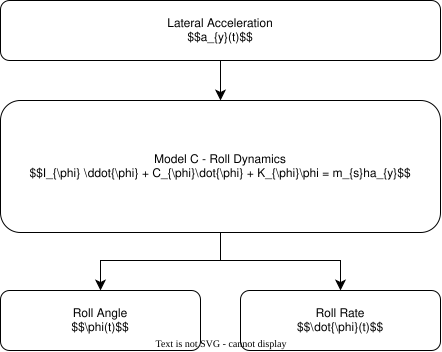
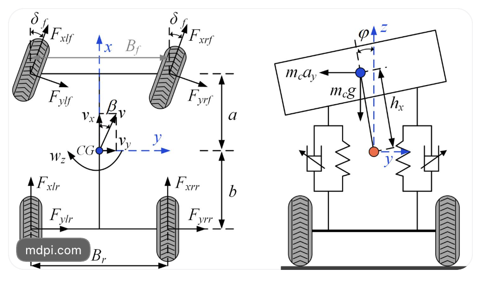
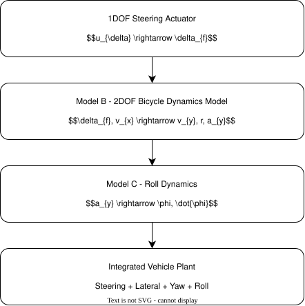
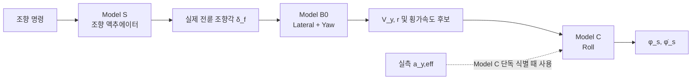

## Model C : Roll Dynamics (3DOF 확장용)
2차 Roll 동역학 / 실차 계측 기반 System Identification

### 1. 모델의 목적
**실차 계측 데이터를 기반으로 횡가속도 (Lateral Acceleration)에 대한 차체의 롤 (Roll) 운동을 푷녀하고, 고유진동수, 감쇠비 및 횡가속도 입력 계수를 식별하여 차체의 롤 동적 응답을 예측하는 모델**이다.

Roll Dynamics Model은 차량의 횡가속도에 의해 발생하는 차체의 롤 운동을 회전 관성, 롤 강성 및 감쇠 특성을 이용한 2차 동역학 시스템 (Second-Order System)으로 근사한 모델이다.

횡가속도에 따른 차체 운동을 이용하여 다음 세 가지 특성을 식별한다.
- Natural Frequency : 차체의 롤 운동이 가는 고유한 진동 특성은 무엇인가?
- Damping Ratio : 발생한 롤 진동이 얼마나 빠르게 감쇠되는가?
- Lateral Acceleration Input Coefficient : 횡가속도가 차체의 롤 운동에 얼마나 큰 영향을 미치는가?

주요 식별 대상은 고유진동수 $\omega_{n}$, 감쇠비 $\zeta$, 횡가속도 입력 계수 $K_{a}$이며, 이를 통해 횡가속도 $a_{y}$에 따른 롤각 $\dot\phi$와 롤가속도 $\ddot{\phi}$를 예측한다.

최종적으로 식별된 파라미터를 상태공간방정식으로 구성하여 **2DOF Bicycle Model에서 계산한 횡가속도와 연계하고, 차량의 Lateral-Yaw-Roll 운동을 표현하는 통합 Vehicle Plant를 구축**을 목표로 한다.

이 모델은 **1개의 회전 자유도 (Roll)를 갖는 2차 시스템**이다.

---
### 2. 도출 파라미터
|파라미터|명칭|의미|
|---|---|---|
|$\omega_{n}$|고유진동수|롤 운동의 고유한 진동 속도|
|$\zeta$|감쇠비|진동이 얼마나 감쇠되는가?|
|$K_{a}$|횡가속도 입력 계수|횡가속도가 롤가속도에 얼마나 영향을 주는가?|
|$G_{\phi a}(0)$|Steady-state Roll Gain|횡가속도 대비 정상상태 상대 롤각|

#### 기초 파라미터
|기호|의미|단위|
|---|---|---|
|$I_{\phi}$|롤축 기준 유효 관성모멘트|$kg \cdot m^{2}$|
|$C_{\phi}$|롤 감쇠계수|$N \cdot m \cdot s/rad$|
|$K_{\phi}$|유효 롤 강성|$N \cdot m / rad$|
|$m_{s}$|롤 운동에 참여하는 차체 질량|$kg$|
|$h_{r}$|롤축과 무게중심 사이 유효 높이|$m$|

본 프로젝트에서는 우선적으로 $\omega_{n}, \zeta, K_{a}$를 식별하고, 물리 제원이 확보되면 강성 / 감쇠계수로 확장한다.

---
### 3. 기본 운동방정식 유도

차량의 Roll 운동은 회전운동에 대한 뉴턴 제2법칙에서 시작한다.
$$\sum M_{x} = I_{\phi}\ddot{\phi}$$

차량이 횡가속도를 받으면 롤축에 대해 외력이 모멘트를 발생시키고, 차체의 롤 강성과 감쇠가 그 운동에 저항한다.

1. 횡가속도로 인한 롤 모멘트
$$M_{a} = m_{s}ha_{y}$$

2. 강성에 대한 복원 모멘트
$$M_{K} = -K_{\phi}\phi$$

3. 감쇠에 의한 저항 모멘트
$$M_{C} = -C_{\phi}\dot{\phi}$$

이를 회전운동 방정식에 대입하면
$$I_{\phi}\ddot{\phi} = m_{s}ha_{y} - K_{\phi}\phi - C_{\phi}\dot{\phi}$$

따라서
$$I_{\phi}\ddot{\phi} + C_{\phi}\dot{\phi} + K_{\phi}\phi = m_{s}ha_{y}$$
가 된다.

이 식이 Roll Dynamics 예측 모델인 Model C의 기본 운동방정식이다.

여기서는 작은 롤각, 선형 감쇠/강성, 고정된 등가 롤축을 가정하며, 중력에 의한 롤 모멘트 효과는 $K_{\phi}$에 포함된 **유효 롤 강성**으로 취급한다.

---
### 4. 표준 2차 시스템으로 변환
앞서 도출한 식을 $I_{\phi}$로 나눈다.
$$\ddot{\phi} + \frac{C_{\phi}}{I_{\phi}}\dot{\phi} + \frac{K_{\phi}}{I_{\phi}}\phi = \frac{m_{s}h}{I_{\phi}}a_{y}$$

제어공학에서 사용하는 표준 2차 시스템은 아래와 같다
$$\ddot{x} + 2\zeta\omega_{n}\dot{x} + \omega_{n}^{2}x = Ku$$

두 식의 계수를 비교하면
$$\omega_{n} = \sqrt{\frac{K_{\phi}}{I_{\phi}}}$$
$$\zeta = \frac{C_{\phi}}{2\sqrt{K_{\phi}I_{\phi}}}$$
$$K_{a} = \frac{m_{s}h}{I_{\phi}}$$
를 얻을 수 있다.

그러므로 최종 식별 대상 방정식은
$$\ddot{\phi} + 2\zeta\omega_{n}\dot{\phi} + \omega_{n}^{2}\phi = K_{a}a_{y}$$
이 된다.

여기서 $\omega_{n}$은 $rad/s$, $\zeta$는 무차원, $K_{a}$는 롤각을 $rad$로 나타냈을 때 $1/m$ 단위를 가진다.

> $K_{a}$는 정상상태 Roll Gain이 아니라 미분방정식의 입력 계수이다.

정상상태에서는 $\dot{\phi} = \ddot{\phi} = 0$이므로
$$\frac{\phi_{ss}}{a_{y}} = \frac{K_{a}}{\omega_{n}^{2}} = \frac{m_{s}h}{K_{\phi}}$$
가 정상상태 Roll Gain이 된다.

---
### 5. 전달함수
초기조건을 0으로 하고 라플라스 변환하면
$$
s^2\Phi(s)+2\zeta\omega_n s\Phi(s)+\omega_n^2\Phi(s)
=K_a A_y(s)
$$

좌변에서 $\Phi(s)$를 묶으면
$$(s^{2} + 2\zeta\omega_{n} s +\omega_{n}^{2})\Phi(s) = K_{a}A_{y}(s)$$

따라서 횡가속도에서 롤각까지의 전달함수는 아래와 같다.

$$G_{C}(s) = \frac{\Phi(s)}{A_{y}(s)} = \frac{K_{a}}{s^{2} + 2\zeta\omega_{n} s +\omega_{n}^{2}}$$

Roll Rate는 Roll Angle의 시간 미분으로, 초기조건 0에서
$$\dot{\Phi}(s) = s\Phi(s)$$
가 된다. 따라서 Roll Rate 전달함수도 얻을 수 있다.

$$G_{\dot{\phi}}(s) = \frac{sK_{a}}{s^{2} + 2\zeta\omega_{n} s +\omega_{n}^{2}}$$

즉, **하나의 2차 모델로 Roll Angle과 Roll Rate를 모두 예측**할 수 있게 된다.

---
### 6. 전달함수의 극점과 안정성
전달함수의 극점은 분모가 0이 되는 지점이다.
$$s^{2} + 2\zeta\omega_{n}s + \omega_{n}^{2} = 0$$

근의 공식을 사용하면
$$p_{1, 2} = -\zeta\omega_{n} \pm \omega_{n}\sqrt{\zeta^{2} - 1}$$

$\omega_{n} > 0, \zeta > 0$이면 이 모델의 극점은 좌반평면에 있어 점근적으로 안정하다.
- $\zeta < 1$ : 복소켤레 극점, 진동 가능
- $\zeta = 1$ : 중복 실극점
- $\zeta > 1$ : 서로 다른 음의 실극점

---
### 7. 상태공간방정식
상태변수를 다음과 같이 정의한다.
$$
x_C=
\begin{bmatrix}
\phi\\
\dot\phi
\end{bmatrix}
$$

입력은 횡가속도이다.
$$u_{C} = a_{y}$$

상태공간방정식의 기본 형태는
$$\dot{x}_{C} = A_{C}x_{C} + B_{C}u_{C}$$
이다.

Roll 운동방정식을 정리하면
$$
\ddot\phi=-\omega_n^2\phi-2\zeta\omega_n\dot\phi+K_a a_y
$$
이고, $x_{C}$를 기준으로 정리하면
$$
\begin{bmatrix}
\dot\phi\\
\ddot\phi
\end{bmatrix}
=
\underbrace{
\begin{bmatrix}
0&1\\
-\omega_n^2&-2\zeta\omega_n
\end{bmatrix}}_{A_C}
\begin{bmatrix}
\phi\\
\dot\phi
\end{bmatrix}
+
\underbrace{
\begin{bmatrix}
0\\K_a
\end{bmatrix}}_{B_C}
a_y
$$
가 된다.

출력으로 Roll Angle과 Roll Rate를 모두 사용한다면,
$$
y_C=
\begin{bmatrix}
1&0\\
0&1
\end{bmatrix}x_C
$$
가 된다.

---
### 8. 이산시간방정식
1DOF Steering Actuator 모델과 동일하게 샘플링 시간 $\Delta{t}$에서 이산화한다.
$$x_{C, k+1} = A_{d}x_{C, k} + B_{d}a_{y, k}$$

ZOH를 가정하면
$$A_d=e^{A_C\Delta t}$$
$$
B_d=
\int_0^{\Delta t}e^{A_Cs}B_C\,ds
$$

실제 구현에서는 행렬지수 기반 ZOH (Zero-Order Hold) 이산화를 사용하거나, 연속시간 모델을 RK4 등으로 적분해 예측 수행할 수 있다.

---
### 9. 파라미터 식별
식별할 파라미터 벡터는
$$\theta_{C} = [\omega_{n} \quad \zeta \quad K_{a}]^{T}$$
이다.

실측 Roll Angle과 Roll Rate를 동시에 사용한다면 목적함수는
$$
J(\theta_C)=
\sum_{k=1}^{N}
\left[
w_\phi(\phi_k-\hat\phi_k)^2+
w_{\dot\phi}(\dot\phi_k-\hat{\dot\phi}_k)^2
\right]
$$
로 설정할 수 있다.

|가중치|대상|의미|
|---|---|---|
|$w_{\phi}$|Roll Angle|롤각 예측 오차의 중요도|
|$w_{\dot{\phi}}$|Roll Rate|롤각속도 예측 오차의 중요도|

각 출력의 단위와 크기가 다르므로 정규화하면
$$
J(\theta_C)=
\sum_{k=1}^{N}
\left[
\left(\frac{\phi_k-\hat\phi_k}{s_\phi}\right)^2+
\left(\frac{\dot\phi_k-\hat{\dot\phi}_k}{s_{\dot\phi}}\right)^2
\right]
$$
로 만들 수 있다.
$s_{\phi}, s_{\dot{\phi}}$는 사전에 정한 대표 오차 척도이며, 가중치는 각각 $1/s_{\phi}^{2}, 1/s_{\dot{\phi}}^{2}$에 해당한다.

#### 식별 절차
1. VBOX에서 Roll Angle, Roll Rate, 횡가속도 추출
2. 단위/부호/영점/시간 확인
3. Roll 과도응답이 충분한 데이터 선정
4. $\omega_{n}, \zeta, K_{a}$ 초깃값 설정
5. 목적함수 최적화
6. 파라미터 식별성 및 미사용 데이터로 검증

---
### 10. VBOX 데이터 및 제약사항
|채널명|용도|주의사항|
|---|---|---|
|`t_s`|시각 [s]|원본 약 200Hz, **실제 채널별 샘플링 타임 확인 필요**|
|`rollAngle_rad`|절대/상대 롤 각 정의 후보|지평면 기준인지, 도로 기준인지 원본 정의 확인 필요|
|`rollRate_radps`|IMU 롤축 각속도 후보|일반적으로 $\dot{\phi}_{s}$와 같다고 가정하면 안됨|
|`pitchAngle_rad`, `pitchRate_radps`, `yawRate_radps`|오일러 각속도 변환/동특성 확인|축/순서/부호 확인 후 적용|
|`ayCG_mps2`|횡가속도 입력 후보|Specific force인지, 중력 보정 가속도인지 확인 필요|
|`Vx_mps`, `Vy_mps`|Dynamics/선회 조건 교차 검증|실제 측정 정의에 맞춰 사용|
|`bank_rad`|노면 뱅크 각 후보|부호/기준면/시간 정렬 확인 필요|
|`suspFLpos_m`, `suspFRpos_m`, `suspRLpos_m`, `suspRRpos_m`|상대 롤의 독립 보조 검증 가능성|실제 단위/영점/센서 기하관계 미확정|

---
### 11. 플랜트 검증 항목
|Maneuver|검증 내용|권장 평가|
|---|---|---|
|Step Steer|Roll 과도응답, 진동, 감쇠|피크 크기, 시각, 오버슈트|
|Sine Steer|Roll 진폭비, 위상응답|주파수별 FRF 후보|
|Double Lane Change|연속적인 Roll 방향 전환|상대 롤각 Free-run 오차|
|Slow Ramp Steer|준정상 Roll Gain|롤 구배 및 히스테리시스|

**각 Maneuver마다 파라미터를 다시 맞추면 의미가 없다.**

**검증 파일별로 파라미터를 재피팅해서 성능을 평가하지 않는다.** 모델 생성에 사용된 파일에서만 계수를 식별하고, 다른 파일에서 롤각 / 롤각속도 RMSE / 피크 / 위상 / 잔차 경향을 평가한다.

단순한 RMSE뿐 아니라 피크 롤각, 피크 발생 시점, 위상지연, 감쇠 특성도 비교하는 것이 좋다.

---
### 12. Model B와 결합
Model C를 독립적으로 식별할 때는 VBOX의 실측 횡가속도를 사용한다.

이후 Model B와 결합할 때는 Model B에서 계산한 횡가속도를 사용한다.

이때 Model B에서 계산하는 횡가속도는
$$a_{y} = \dot{v}_{y} + v_{x}r$$
가 된다.

통합 상태변수는 다음과 같이 구성할 수 있다.
$$x_{S+B+C}=[\delta_f,\ v_y,\ r,\ \phi_s,\ \dot\phi_s]^{T}$$

이는 **조향 액추에이터 1상태 + 차량 Lateral/Yaw/Roll 3DOF** 구조이다.

#### 12.1 단계별 결합
1. **Model C 단독 식별** : 검증된 **실측 $a_{y, eff}$** 를 입력으로 사용한다.
2. **단방향 B0 -> C** : Model B0가 예측한 횡속도 / 요레이트에서 정의에 맞는 횡방향 가속도를 계산하여 C에 제공한다. 이 단계에서 B0의 오차가 C로 전달될 수 있다.
3. **완전 결합 Lateral-Yaw-Roll** : 롤 하중 이동에 따른 타이어 힘 변화 등을 추가하면 B와 C가 양방향으로 계산된다. 이는 후속 모델 개발 범위에 속한다.

현재 B0의 횡방향 동역학에서 계산되는 가속도는
$$a_{y}^{kinematic} = \dot{v}_{y} + v_{x} r$$

Model S의 **조향 명령 / 실제각 쌍이 확보되지 않은 상태에서는 S를 식별 완료된 요소로 표시하지 않는다.**  

#### 12.2 통합 상태 벡터
Model S (1DOF) + B0 (2DOF) + C (2DOF)를 직렬로 묶은 경우의 **5개 상태**는
$$x_{S + B + C} = [\delta_{f}, v_{y}, r, \phi_{S}, \dot{\phi}_{S}]^{T}$$

이는 **차량의 일반화 자유도 Lateral - Yaw - Roll 3개와, 조향 액추에이터 상태 1개를 포함한 5DOF 모델**이다. "3DOF"는 차량의 운동 자유도 수를 말한다.

---
### 13. Model C 완료 기준
|항목 (가명칭)|완료 기준|
|---|---|
|C-DATA|실제 롤 신호 / 시간축 / 좌표계 / 유효 횡가속도 정의 문서화|
|C-MODEL|2차 상대 롤 방정식 / 단위 / 부호 구현 및 단위 시험|
|C-ID|$omega_{n}$, $\zeta$, $K_{a}$ 식별 및 제약 검증|
|C-IDENT|민감도, 상관성, 필터 / 초기조건 의존성 분석|
|C-VAL|학습에 사용하지 않은 파일로 검증|
|C-EXPORT|계수 / 좌표계 / 입력 정의 / 적용 범위 / 출처 / 불확실성|
|C-INTEGRATE|B0 -> C 인터페이스의 시간 정렬 / 부호 / 재현성|