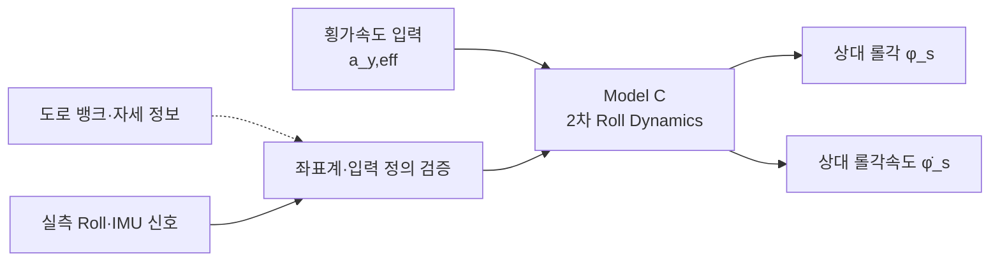
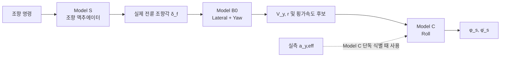

# Model C — Roll Dynamics (3DOF Vehicle Plant 확장용)

> **P4 Vehicle System Identification | 기술 정의서 · 검토 개정본**  
> **상태:** 이론 모델·식별/검증 계획 확정용 문서. **Stanford VW Golf의 Model C 계수는 아직 식별되지 않음.**  
> **담당:** Model C (Roll Dynamics) — 후배 담당  
> **모델 경계:** Model S = 조향 액추에이터, Model A/A-Speed = 1차 요레이트 기준 모델, Model B0 = 횡속도·요레이트 2DOF Bicycle, Model C = 차체 롤 1DOF(2차 동역학)

## 1. 모델의 목적

**실차에서 계측한 횡방향 운동과 차체 롤 응답을 바탕으로, 차체의 상대 롤각 및 롤각속도를 예측하는 2차 동역학 모델을 식별한다.** 이를 통해 고유진동수, 감쇠비, 횡가속도 입력 계수 및 정상상태 롤 구배를 추정한다.

Model C는 횡가속도에 의해 발생하는 차체 롤 운동을 유효 롤 관성·강성·감쇠로 근사한 **1개 회전 자유도, 2개 상태의 모델**이다. 차량 전체에 적용하면 Model B0의 횡방향·요 운동에 롤 자유도를 더해 Lateral–Yaw–Roll **3DOF**의 구조로 확장할 수 있다. 단, 본 문서의 1차 구현은 **Model B와 양방향 연성된 완전한 3DOF 차량 모델이 아니라, 측정된 횡가속도를 입력받는 독립 Roll 서브모델**이다.

예측 출력은 **상대 롤각** $\phi_s$와 **상대 롤각속도** $\dot\phi_s$이며, 필요하면 $\ddot\phi_s$도 계산한다. $\phi_s$를 도로 기준으로 정의하는 경우, IMU의 절대 롤각을 그대로 상태로 사용해서는 안 된다.

## 2. 도출 파라미터

### 2.1 우선 식별할 정규화 파라미터

| 파라미터 | 명칭 | 정의/의미 | 단위 |
|---|---|---|---|
| $\omega_n$ | Natural Frequency | 2차 롤계 고유각진동수 | rad/s (관례상 $\mathrm{s}^{-1}$) |
| $\zeta$ | Damping Ratio | 감쇠비 | 무차원 |
| $K_a$ | Lateral Acceleration Input Coefficient | **롤가속도 방정식**에 대한 횡가속도 입력 계수 | rad/m (rad를 무차원으로 취급 시 $\mathrm{m}^{-1}$) |
| $G_{\phi a}(0)$ | Steady-state Roll Gain | 횡가속도 대비 정상상태 상대 롤각 | rad/(m/s²) |

여기서 **$K_a$와 정상상태 롤 이득은 다른 값**이다.

### 2.2 기초 물리 파라미터

| 기호 | 의미 | 단위 | 현재 상태 |
|---|---|---|---|
| $I_\phi$ | 선택한 롤축 기준의 유효 관성모멘트 | kg·m² | 미확정 |
| $C_\phi$ | 유효 롤 감쇠계수 | N·m·s/rad | 절대값 미확정 |
| $K_{\phi,\mathrm{eff}}$ | 중력 복원 효과까지 일관되게 포함한 유효 롤 강성 | N·m/rad | 절대값 미확정 |
| $m_s$ | 롤 운동에 참여하는 스프렁 질량 | kg | 미확정 |
| $h_r$ | 롤축과 스프렁 질량 중심 사이 유효 모멘트 암 | m | 미확정 |

**1차 목표는 $\omega_n,\zeta,K_a$를 계측값에서 식별하는 것**이다. $m_s,h_r,I_\phi$가 없는 상태에서 $C_\phi,K_{\phi,\mathrm{eff}}$의 절대값이 식별되었다고 주장하지 않는다. $h_r$는 지면 기준 CG 높이와 같지 않을 수 있다.

## 3. 기본 운동방정식 유도 및 적용 가정

스프렁 질량의 롤 운동을 작은 각도, 유효 강성·선형 감쇠 및 고정된 등가 롤축으로 근사하면 다음의 **후보 식**을 둔다.

$$
I_\phi\ddot\phi_s + C_\phi\dot\phi_s + K_{\phi,\mathrm{eff}}\phi_s
= s_a\,m_sh_r a_{y,\mathrm{eff}} + M_0
$$

- $\phi_s$: **노면 기준 차체 상대 롤각** [rad]
- $a_{y,\mathrm{eff}}$: 해당 롤 모멘트 방정식과 부호·중력 처리 정의가 일치하는 **유효 횡가속도 입력** [m/s²]
- $s_a\in\{-1,+1\}$: 신호 축 정의에 따른 부호. 자료로 검증 전까지 고정하지 않음
- $M_0$: 비대칭 하중·센서 오프셋 등 정적 효과를 모은 후보 상수 모멘트. 기준 동작점에서 제거 가능하면 0으로 둠

원문 식 $I_\phi\ddot\phi+C_\phi\dot\phi+K_\phi\phi=m_sha_y$는 **$s_a=+1$, $M_0=0$이고 상대 롤각 및 횡가속도 정의가 서로 일치할 때의 특수 형태**다. 따라서 원문의 수식 자체는 일반적인 등가 롤 모델로 성립하지만, Stanford CSV에 곧바로 대입할 물리적 부호가 검증된 것은 아니다.

물리적 항은 다음과 같이 해석한다.

$$M_a=s_a m_sh_ra_{y,\mathrm{eff}},\qquad
M_K=-K_{\phi,\mathrm{eff}}\phi_s,\qquad
M_C=-C_\phi\dot\phi_s$$

**중력과 도로 뱅크에 대한 주의:** 중력에 의한 롤 복원 효과를 $K_{\phi,\mathrm{eff}}$에 포함할 수 있지만, 이 사실만으로 **도로 뱅크가 만들어내는 평형 롤각 또는 외력**까지 자동으로 반영되는 것은 아니다. $a_{y,\mathrm{eff}}$가 무엇인지 확정하지 않고 $g\sin(\mathrm{bank})$를 더하거나 빼면 중복 보정이 발생할 수 있다.

## 4. 표준 2차 시스템 및 롤 구배

$M_0$를 기준 동작점에서 제거하고, 정규화하여

$$
\ddot\phi_s+a\dot\phi_s+b\phi_s=k_a a_{y,\mathrm{eff}}
$$

로 쓴다. 여기서

$$
a=\frac{C_\phi}{I_\phi},\qquad
b=\frac{K_{\phi,\mathrm{eff}}}{I_\phi},\qquad
k_a=\frac{s_a m_sh_r}{I_\phi}.
$$

원문의 $K_a$는 여기서 **부호를 포함한 $k_a$**에 대응한다. 2차 시스템 표준형은

$$
\boxed{\ddot\phi_s+2\zeta\omega_n\dot\phi_s+\omega_n^2\phi_s=K_a a_{y,\mathrm{eff}}}
$$

이며

$$
\omega_n=\sqrt{b},\qquad
\zeta=\frac{a}{2\sqrt{b}},\qquad K_a=k_a.
$$

따라서

$$
G_{\phi a}(0)=\frac{K_a}{\omega_n^2},\qquad
RG_{\mathrm{deg/g}}=\frac{K_a}{\omega_n^2}\,g\,\frac{180}{\pi}.
$$

$RG$는 선택한 롤각·가속도 부호에 따른 **부호 있는 롤 구배**다. 절댓값을 비교할 때는 $|RG|$를 사용한다. 일반적인 승용차의 경험적 범위는 물리적 합격 판정이 아니라 초기 합리성 확인에만 활용한다.

**식별 가능성:** $a,b,K_a$가 데이터로 구별되더라도 $I_\phi,C_\phi,K_{\phi,\mathrm{eff}},m_s,h_r$를 각각 독립적으로 얻었다는 뜻은 아니다.

## 5. 전달함수

초기조건을 0으로 한 **편차변수** $\Delta\phi_s,\Delta a_{y,\mathrm{eff}}$에 대해

$$
(s^2+2\zeta\omega_ns+\omega_n^2)\Delta\Phi_s(s)=K_a\Delta A_y(s)
$$

이므로

$$
G_C(s)=\frac{\Delta\Phi_s(s)}{\Delta A_y(s)}
=\frac{K_a}{s^2+2\zeta\omega_ns+\omega_n^2}.
$$

상대 롤각속도 출력의 전달함수는

$$
G_{\dot\phi_s}(s)=sG_C(s)=\frac{sK_a}{s^2+2\zeta\omega_ns+\omega_n^2}.
$$

**용어 구분:** $\dot\phi_s$는 롤각속도(Roll angular rate), $\ddot\phi_s$는 롤각가속도(Roll angular acceleration)다. CSV의 IMU `rollRate_radps`가 곧바로 $\dot\phi_s$인지는 별도 확인해야 한다.

## 6. 전달함수의 극점과 안정성

$$
p_{1,2}=-\zeta\omega_n\pm\omega_n\sqrt{\zeta^2-1}.
$$

$\omega_n>0$, $\zeta>0$이면 연속시간 2차 모델의 극점 실수부는 음수이고 점근적으로 안정적이다. $0<\zeta<1$은 부족감쇠, $\zeta=1$은 임계감쇠, $\zeta>1$은 과대감쇠다. **모델의 극점 안정성이 실제 차량 전체의 안정성을 보장하지는 않는다.**

## 7. 상태공간방정식

상대 롤 상태를

$$
x_C=\begin{bmatrix}\phi_s\\\dot\phi_s\end{bmatrix},\qquad u_C=a_{y,\mathrm{eff}}
$$

로 정의하면

$$
\dot x_C=
\underbrace{\begin{bmatrix}0&1\\-\omega_n^2&-2\zeta\omega_n\end{bmatrix}}_{A_C}x_C+
\underbrace{\begin{bmatrix}0\\K_a\end{bmatrix}}_{B_C}u_C.
$$

출력 $y_C=[\phi_s,\dot\phi_s]^T$를 사용하면 $C_C=I_2,D_C=0$이다. 측정계와 비교할 때 센서 바이어스·관측 연산을 별도로 두는 것이 적절하다.

## 8. 이산시간방정식

샘플링 주기 $\Delta t$에서 입력을 구간 내 일정하게 유지하는 ZOH의 **정확한 선형 이산화**는

$$
x_{C,k+1}=A_d x_{C,k}+B_du_{C,k},\qquad
A_d=e^{A_C\Delta t},\qquad
B_d=\int_0^{\Delta t}e^{A_C\tau}B_C\,d\tau.
$$

C++17 구현에서는 행렬지수 기반 ZOH, RK4 또는 기존 공통 적분기를 이용할 수 있으나, **구현 방식과 평가 기준의 시간 정렬을 명시**한다. Model B0에서 사용한 Implicit Midpoint와 Model C의 수치적분 방식을 같게 해야 하는 것은 아니다. 다만 Export·Reload Parity에서는 같은 적분 경로를 사용해야 한다.

## 9. 파라미터 식별

### 9.1 식별 파라미터

$$
\theta_C=[\omega_n,\zeta,K_a]^T
$$

또는 내부적으로 $[a,b,K_a]$를 먼저 추정해 변환할 수 있다. **$\omega_n>0,\zeta>0$ 제약**을 적용하며, 입력 부호가 불확실한 동안 $K_a$의 부호를 데이터와 좌표계 검증으로 판단한다.

### 9.2 출력오차 목적함수

실측 상대 롤각과 상대 롤각속도가 모두 타당하게 확보된 경우,

$$
J(\theta_C)=\sum_{e\in\mathcal E_{\rm train}}\sum_{k\in e}
\left[
\left(\frac{\phi_{s,k}^{\rm meas}-\hat\phi_{s,k}}{s_\phi}\right)^2+
\left(\frac{\dot\phi_{s,k}^{\rm meas}-\hat{\dot\phi}_{s,k}}{s_{\dot\phi}}\right)^2
\right].
$$

여기서 $s_\phi,s_{\dot\phi}$는 **학습 데이터에서만 결정한 정규화 척도**다. `rollRate_radps`를 상대 롤각속도로 해석할 근거가 없다면 해당 항을 목적함수에서 제외하고, 상대 롤각만으로 식별한 뒤 별도 일관성 검증을 수행한다.

### 9.3 필터 기반 식별 대안

상대 롤각의 **이중 수치 미분을 그대로 사용하면 노이즈가 증폭**되므로, 초기 회귀에서는 다음 두 방법 중 하나를 권장한다.

- **SVF(State-Variable Filter):** $\phi_s$ 및 $a_{y,\mathrm{eff}}$에 동일한 안정 필터를 적용하여 미분형 회귀를 구성한다. 필터 주파수에 따라 계수가 달라지는지 검증한다.
- **적분형 회귀:** 일정 구간의 상태 변화와 입력 적분으로 식을 구성하여 미분 노이즈를 완화한다. 적분 구간 경계의 초기조건과 오프셋을 함께 처리한다.

어느 방식이든 결과는 **미사용 주행 파일에서 자유 응답(Free-run)**으로 검증한다. 한 파일의 여러 슬라이딩 구간을 학습/검증에 무작위로 나누면 세션 의존성에 의한 누출 위험이 있다.

### 9.4 식별 절차

1. 로그 원본과 채널 정의 확보, 타임스탬프·단위·좌표계 확인
2. 롤각·뱅크·롤레이트·횡가속도 오프셋 및 시간 정렬 확인
3. 도로 기준 상대 롤각과 유효 횡가속도 **후보 정의를 문서화**
4. 다양한 좌·우 선회 및 과도 롤 가진 구간 추출
5. $\theta_C$ 초기 추정, 식별 및 잔차 분석
6. 민감도·파라미터 상관성·필터 의존성 점검
7. 독립 파일 검증: 롤각/롤속도 RMSE, 피크, 위상, 고유진동수, 롤 구배
8. 입출력 정의·가정·검증 범위를 포함한 Model C Export

## 10. 계측 데이터 및 핵심 제약사항

### 10.1 Stanford VW Golf (현재 확보한 실제 CSV)

| CSV 채널 | 용도 | 주의사항 |
|---|---|---|
| `t_s` | 시각 [s] | 원본 약 200Hz; **실제 신호별 갱신 속도 별도 확인** |
| `rollAngle_rad` | 절대/상대 롤각 정의 후보 | 지평면 기준인지 도로 기준인지 원본 정의 확인 |
| `rollRate_radps` | IMU 롤축 각속도 후보 | 일반적으로 $\dot\phi_s$와 같다고 가정하면 안 됨 |
| `pitchAngle_rad`, `pitchRate_radps`, `yawRate_radps` | 오일러 각속도 변환·동특성 확인 | 축·순서·부호 확인 후 적용 |
| `ayCG_mps2` | 횡가속도 입력 후보 | specific force인지 중력 보정 가속도인지 미확정 |
| `Vx_mps`, `Vy_mps` | 운동학·선회 조건 교차검증 | 실제 측정 정의에 맞춰 사용 |
| `bank_rad` | 노면 뱅크각 후보 | 부호·기준면·시간 정렬 확인 필요 |
| `suspFLpos_m`, `suspFRpos_m`, `suspRLpos_m` | 상대 롤의 독립 보조 검증 가능성 | 실제 단위·영점·센서 기하관계 미확정 |

**기준면 처리의 출발 가정(확정 사실 아님):** `rollAngle_rad`가 수평 기준 전체 차체 롤각이고 `bank_rad`가 동일 회전 부호의 노면 기울기일 경우 작은 각도에서 $\phi_s\approx\phi_{\rm total}-\phi_{\rm road}$가 가능하다. 반대 부호 규약이면 부호 변환이 필요하다. 직선 뱅크 구간의 각도 유사성만으로 이 관계를 **100% 확정할 수 없다.**

**롤레이트 처리:** IMU의 차체 고정축 각속도를 $(p,q,r)$, 오일러 롤·피치각을 $(\phi,\theta)$라 하면 통상적인 한 오일러각 규약에서는

$$
\dot\phi_{\rm total}=p+\tan\theta\,(q\sin\phi+r\cos\phi).
$$

그러나 이는 해당 오일러각·축 규약이 맞을 때의 식이다. 상대 롤각속도는 노면 기준 좌표계의 회전까지 고려해야 하며, 단순히 `rollRate_radps` 또는 $p-d(\mathrm{bank})/dt$라고 단정할 수 없다. 현재는 **상대 롤각을 기반으로 SVF/적분형 식별을 우선**한다.

**횡가속도 처리:** `ayCG_mps2`가 이미 중력 보정된 값인지 알기 전에는 $\pm g\sin(\mathrm{bank})$를 기계적으로 추가하지 않는다. Model B0의 현재 `+g sin(bank)` 항도 좌표계 감사 미완료 상태이므로, Model C 입력의 정답으로 자동 채택하지 않는다.

### 10.2 기존 VBOX 데이터 (초기 검토 경로)

| VBOX 채널 | 의미/역할 | 조건 |
|---|---|---|
| `Roll_Angle` | 롤각 후보 | 기준면 확인 |
| `RollRate` | 롤레이트 후보 | 차체축 $p$와 오일러 롤각 미분 구별 |
| `Lat accel g`, `Y_Accel` | 횡가속도 후보 | 단위 변환·중력 처리 확인 |
| `YawRate` | 선회 상태 | 부호 확인 |
| `velocity kmh` | 속도 | m/s 변환 |

초기 VBOX의 신호 정의가 불확실하면 Stanford Golf 신호와 **혼합 식별하지 않는다.** 데이터셋별 신호 정의를 독립적으로 보존한다.

## 11. 플랜트 검증 항목

| Maneuver | 검증 항목 | 권장 평가 |
|---|---|---|
| Step Steer | 롤 과도응답, 고유 주파수, 감쇠 | 피크 크기·시각, 오버슈트 |
| Sine Steer | 진폭비·위상 지연 | 주파수별 FRF 후보 |
| Double Lane Change | 좌우 전환·비대칭 | 상대 롤각 Free-run 오차 |
| Slow Ramp Steer | 준정상 롤 구배 | $RG$ 및 히스테리시스 |
| 직선·뱅크 구간 | 기준면·오프셋 검토 | 롤각·도로뱅크의 부호와 차이 |

**검증 파일별로 파라미터를 재피팅해서 성능을 평가하지 않는다.** 훈련 파일에서만 계수를 식별하고, 다른 파일에서 롤각·롤각속도 RMSE, 피크, 위상, 잔차 경향을 평가한다. 식별 불가능한 구간(가진 부족, 신호 정의 불명)은 합격 판정 대신 사유를 기록한다.

## 12. Model B와 결합 및 통합 상태 정의

### 12.1 단계별 결합

1. **Model C 단독 식별:** 검증된 **실측** $a_{y,\mathrm{eff}}$를 입력으로 사용한다.
2. **단방향 B0 → C:** Model B0가 예측한 횡속도·요레이트에서 정의에 맞는 횡방향 가속도를 계산하여 C에 공급한다. 이 단계에서 B0의 오차가 C로 전달될 수 있다.
3. **완전 결합 Lateral–Yaw–Roll:** 롤 하중 이동에 따른 타이어 힘 변화 등을 추가하면 B와 C가 양방향으로 연성된다. 이는 별도의 후속 모델 개발 범위다.

현재 B0의 횡방향 운동학에서 계산되는 가속도는 (회전 좌표계 가정 하에)

$$
a_y^{\rm kin}=\dot v_y+v_xr.
$$

하지만 이것을 `ayCG_mps2` 또는 $a_{y,\mathrm{eff}}$와 일치시키려면 중력·뱅크·좌표계 보정 정의를 먼저 확인해야 한다.

Model S의 **조향 명령/실제각 쌍이 확보되지 않은 상태에서는 S를 식별 완료된 요소로 표시하지 않는다.** 기존 Golf CSV의 `roadWheelAngle_rad`는 B0 입력으로 사용되지만, 그 자체로 S의 명령각이 아니다.

### 12.2 통합 상태벡터

Model S(1상태) + B0(2상태) + C(2상태)를 직렬로 묶은 경우의 **5개 상태**는

$$
\boxed{x_{S+B+C}=[\delta_f,\;v_y,\;r,\;\phi_s,\;\dot\phi_s]^T.}
$$

이는 **차량의 일반화 자유도 Lateral·Yaw·Roll 3개와, 조향 액추에이터 상태 1개를 포함한 5상태 모델**이다. "3DOF"는 차량의 운동 자유도 수를 말하며, "5상태"와 모순되지 않는다. 조향 동역학을 제외한 B0+C는 4상태 모델이다.

## 13. Model C 완료 기준

| 검증 게이트 | 필수 조건 | 현 상태 |
|---|---|---|
| C-DATA | 실제 롤 신호·시간축·좌표계·유효 횡가속도 정의 문서화 | **미완료** |
| C-MODEL | 2차 상대 롤 방정식·단위·부호 구현 및 단위시험 | 미완료 |
| C-ID | $\omega_n,\zeta,K_a$ 식별 및 제약 검증 | 미완료 |
| C-IDENT | 민감도, 상관성, 필터/초기조건 의존성 분석 | 미완료 |
| C-VAL | 학습에 사용하지 않은 파일로 Free-run 검증 | 미완료 |
| C-EXPORT | 계수·좌표계·입력 정의·적용 범위·출처·불확실성 Export | 미완료 |
| C-INTEGRATE | B0 → C 인터페이스의 시간 정렬·부호·재현성 검사 | 미완료 |

**현재 완료된 것은 Model C의 이론 정의와 식별/검증 계획이다.** A/A-Speed/B0의 기존 V1 결과가 Model C의 검증을 대신하지 않는다. V1 Golf 기준 계수는 변경하지 않는다.

## 부록 A. 원문 대비 주요 수정 사항

| 중요도 | 원문/기존 표현 | 개정 내용 | 이유 |
|---|---|---|---|
| 필수 | "$\phi$와 롤가속도 $\dot\phi$ 예측" | "$\phi_s$, $\dot\phi_s$ 예측; $\ddot\phi_s$ 계산 가능" | 롤각속도와 롤각가속도 혼동 수정 |
| 필수 | Roll Angle $\phi$를 기준면 구분 없이 사용 | 도로 기준 **상대 롤각 $\phi_s$**와 IMU 전체 롤각 구분 | 뱅크 노면의 오적용 방지 |
| 필수 | `RollRate`를 $\dot\phi$로 직접 사용 | 차체 고정축 $p$와 오일러 롤각 미분 및 도로 기준 상대 미분 구분 | 실제 계측 정의 검증 필요 |
| 필수 | $m_sha_y$를 부호·중력 가정 없이 입력 | $s_am_sh_ra_{y,\mathrm{eff}}$ 및 신호 정의 검증 | 뱅크/중력 중복 보정 방지 |
| 중요 | "$K_a$는 $1/m$" | rad/m (각도 무차원 관례 시 $\mathrm{m}^{-1}$) 및 정상상태 Roll Gain과 명확히 구분 | 단위·개념 명료화 |
| 중요 | Roll 결과를 `$\phi$와 $\dot\phi$`로 쓸 때 IMU 측정값과 직접 동일시 | 관측/좌표변환 전제조건 추가 | 잘못된 목적함수 방지 |
| 중요 | Model B에서 $a_y=\dot v_y+v_xr$를 무조건 그대로 입력 | 운동학 가속도와 롤 입력의 중력·뱅크 정의를 검증 후 연결 | B0와 C 인터페이스 안전성 |
| 중요 | 3DOF/통합 상태 수 혼동 가능 | B0+C = 4상태, S+B0+C = 5상태, 차량 운동 3DOF | DOF와 상태수 분리 |
| 중요 | 원문 VBOX 채널만 기재 | 실제 사용 가능한 Stanford VW Golf CSV 채널 추가 | 실질적 착수 자료 확보 |
| 중요 | 단순 RMSE 중심 | 파일 단위 CV, 파라미터 민감도, 피크·위상, Export 게이트 | P4 공통 검증 원칙 적용 |
| 편집 | 오타·LaTeX 탈자 및 `\\` 누락 | 통일된 표기·수식으로 정리 | 문서 렌더링 및 전달성 개선 |

## 부록 B. 참고 데이터 출처

- **Stanford Digital Repository, VW Golf vehicle dynamics dataset:** https://purl.stanford.edu/hh613qz0317
- **사용 실험 로그:** 2023년 10·11월 CSV 중 P4에서 중복 제거한 20개 파일. **이 문서에 Model C의 실측 식별 결과는 포함되지 않는다.**
- **라이선스:** 원본 저장소의 라이선스 표기를 별도 확인 후 기재한다. 임의로 CC BY라고 단정하지 않는다.

