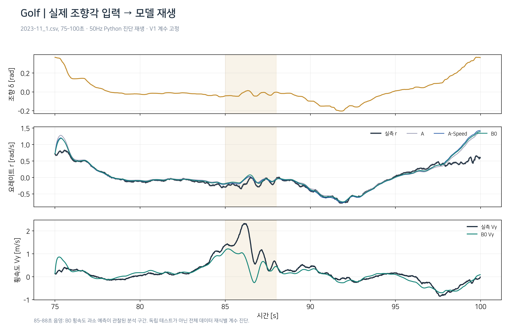

# P4 Vehicle System Identification — Technical Review

## 1. 계측 조향각을 그대로 입력한 재생

- 파일: `2023-11_1.csv`, 75–100초, 50 Hz Python 시각화 진단.
- 모델 예측: A yaw RMSE 0.16430, A-Speed yaw 0.17748, B0 yaw 0.16881 rad/s, B0 Vy 0.29989 m/s (해당 진단 실행 기준).
- 특히 86.14초: 계측 \(v_y=2.31m/s\), B0 자유응답 \(v_y=0.91m/s\). **모델이 특정 과도응답을 과소 예측**한다.
- 위 재생은 **전체 재식별 계수를 이용한 학습 포함 파일 진단**이다. 홀드아웃 교차검증과 혼동하지 않는다. Python 50 Hz와 C++ 200 Hz 평가 수치는 샘플/입력 보간 조건이 다르다.

## 2. 기술적 한계 및 V1 감사 항목

1. **원본 신호 물리 정의**: 조향각 기준, yaw/roll 부호, bank 부호, `ayCG` 중력 보정 확인.
2. **식별 가능성**: Golf \(l_f\)–\(I_z/m\) 결합, 타이어 등가 강성을 절대 측정값으로 오인 금지.
3. **독립 검증 수준**: 파일 단위 5-fold는 확인됐지만, 같은 원주행 세션의 파일 간 중복·상관성은 추가 확인 필요.
4. **모델의 유효 영역**: 작은 슬립각 선형 근사, \(v_x\ge5m/s\), observed p05–p95 범위는 보장된 정확도 범위가 아님.
5. **모델/문서 불일치**: 첨부된 Model S/A/B/C 초안의 수식 오기와 상태 정의를 별도 문서에서 수정 제안.

---

### 참고 파일 / 재현 경로

- 사용자 프로젝트: `config/golf_baselines.json`, `output/golf_prediction_horizon_001.json`, `output/golf_controller_model.json`, `output/golf_export_parity.json`.
- 이전 작업 기록: `GOLF_MODEL_B.md`, `GOLF_B0_B1.md`, `P4_PREDICTION_HORIZON.md`, `P4_CONTROLLER_INTEGRATION.md`.
- 그림은 **P4의 직접 작성 모델 도식 2장 + 실제 Golf 데이터·실험 결과 그림 2장**. 외부 이미지 미사용.
- 보완 사항: [P4_Model_Document_Review.md](P4_Model_Document_Review.md).
